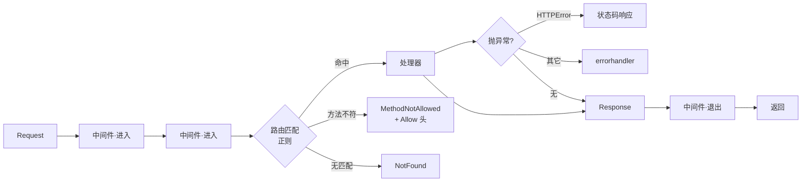

<div align="center">

# Onyx

### 一个零依赖的 Python 微 Web 框架 —— 路由、中间件、请求生命周期，全部用标准库实现

[](https://github.com/WsNodeX/onyx/stargazers)
[](https://github.com/WsNodeX/onyx/releases)
[](LICENSE)

</div>

---

主流框架要么是全家桶，要么得先读懂一堆抽象才能写第一行。Onyx 反过来：路由怎么匹配、
中间件怎么串、异常怎么变响应，全部摊开，都在你能读完的代码里。

`app` 本身就是一个合法的 WSGI 应用，可以直接挂到 gunicorn。

## 快速开始

```python
from onyx import Onyx, NotFound, Response

app = Onyx(__name__)

@app.get("/users/<id:int>")
def get_user(request):
    # route params arrive on request.path_params, NOT as function arguments
    return {"id": request.path_params["id"], "name": f"user-{request.path_params['id']}"}

@app.post("/echo")
def echo(request):
    return Response.json(request.json, status_code=201)

if __name__ == "__main__":
    app.run(port=8000)
```

```bash
python app.py                      # 内置单线程服务器
curl http://127.0.0.1:8000/users/42
```

测试不建 socket：

```python
client = app.test_client()
resp = client.get("/users/42")
assert resp.status_code == 200
```

## 四种路由转换器

| 写法 | 匹配 | 传进处理器的类型 |
|---|---|---|
| `<id:int>` | 整数 | `int` |
| `<amount:float>` | 浮点 | `float` |
| `<slug>` | 默认，不含 `/` | `str` |
| `<path:path>` | 含 `/` | `str` |

编译成正则后精确匹配，不靠字符串前缀试探。

## 错误即响应

```python
@app.get("/admin")
def admin(request):
    raise NotFound("no such page")     # 自动变成 404 响应

@app.errorhandler(ValueError)
def on_bad_value(exc):                 # 只接收异常，不接收 request
    return {"error": str(exc)}, 400
```

抛出 `NotFound` / `MethodNotAllowed` 等，框架转成带正确状态码的响应 ——
`MethodNotAllowed` 还会自动带上 `Allow` 头。任何其它异常都能用 `errorhandler` 接管。

## 返回值可以是四种形态

```python
return Response(...)                 # 直接用
return {"ok": True}                  # dict -> JSON
return "hello"                       # str -> text/plain
return {"ok": False}, 400, {"X-Why": "bad"}   # (body, status, headers)
```

## 请求怎么走



中间件是洋葱模型：注册顺序即执行顺序，进出对称。

## 模块化

```python
from onyx import Blueprint

api = Blueprint("api", url_prefix="/api")

@api.get("/health")
def health(request):
    return {"ok": True}

app.register_blueprint(api)
```

## 安装

把 `onyx/` 目录放进你的项目即可 —— 不需要 `pip install`，没有依赖。

## 测试

```bash
python -m pytest -q
```

`test_client()` 把请求直接喂进 `handle()`，不建 socket，所以测试是秒级且确定的。

## 限制

- **单线程内置服务器。** `app.run()` 只是开发兜底，一次处理一个连接。生产用 gunicorn 挂
  WSGI —— 但那就不是"零依赖"了。
- **没有模板引擎。** 只返回 JSON / 字符串 / bytes / Response。要做 HTML 得自己拼或接第三方。
- **没有 ORM、没有迁移、没有后台管理。** 这是一个路由 + 中间件 + 生命周期的教学级内核，
  不是 Django 的替代品。
- **不做 websocket / SSE。** WSGI 本身是请求-响应模型，长连接不在范围内。

## License

[MIT](LICENSE)
